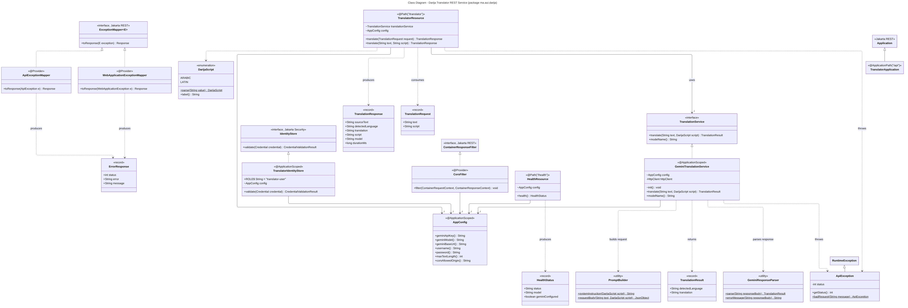
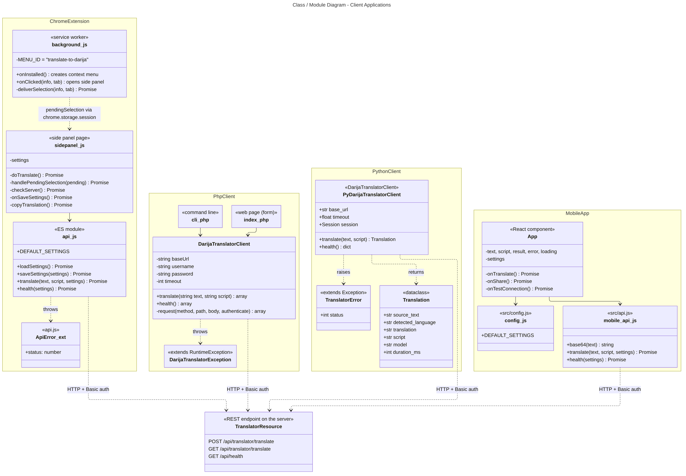
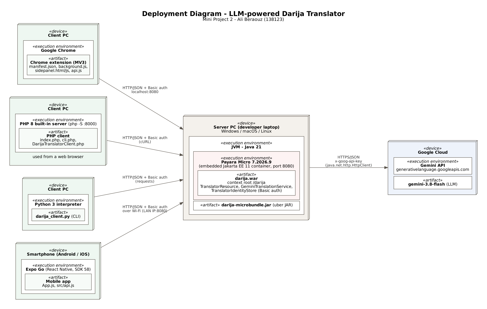
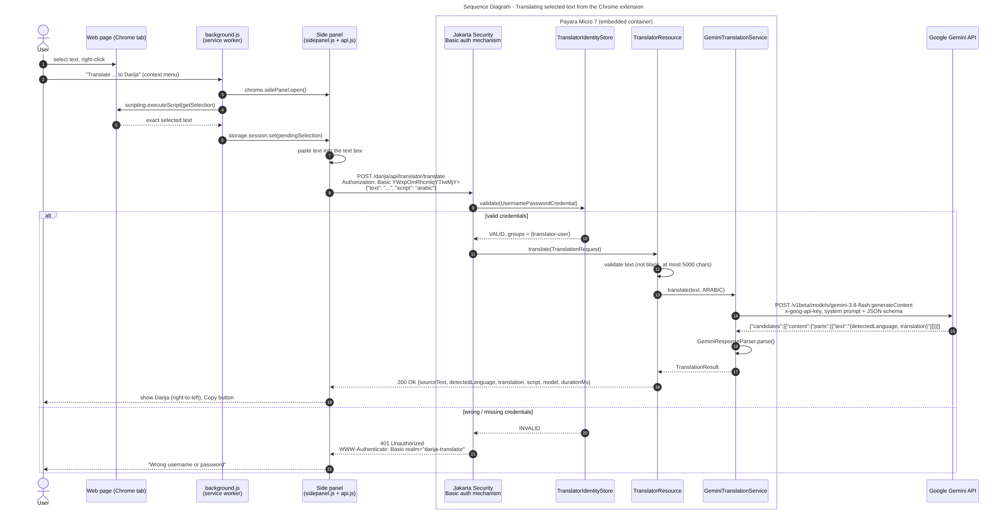

# Darija Translator: LLM-powered RESTful Web Service

**Mini Project 2**, translating text from any language (English, French, Spanish…) into **Moroccan Arabic (Darija)** with a Large Language Model (Google Gemini).

**Student:** Ali Beraouz, ID 138123

| Component | Technology | Folder |
|---|---|---|
| REST web service (`TranslatorResource.translate()`) | Java 21, Jakarta EE 11 (Jakarta REST, CDI, JSON-B/JSON-P, Jakarta Security / Authentication), **Payara Micro 7** embedded container, Maven | [`server/`](server) |
| LLM | Google Gemini API (`gemini-3.8-flash`, free tier, configurable) | (called by the server) |
| Chrome extension | Manifest V3, `chrome.sidePanel`, context menu, `chrome.scripting` | [`chrome-extension/`](chrome-extension) |
| PHP client | PHP 8 + cURL (web page + command line) | [`clients/php/`](clients/php) |
| Python client | Python 3 + `requests` (command line, interactive mode) | [`clients/python/`](clients/python) |
| Mobile app | React Native with **Expo SDK 58** (runs in Expo Go) | [`clients/mobile/`](clients/mobile) |
| UML diagrams | Class (server + clients), sequence, deployment | [`docs/uml/`](docs/uml) |

---

## Table of contents

1. [Architecture](#1-architecture)
2. [Project structure](#2-project-structure)
3. [Prerequisites](#3-prerequisites)
4. [Run the REST web service](#4-run-the-rest-web-service)
5. [API reference](#5-api-reference)
6. [Security (HTTP Basic authentication)](#6-security-http-basic-authentication)
7. [Testing the service (cURL, Postman, unit tests)](#7-testing-the-service)
8. [Chrome extension](#8-chrome-extension)
9. [PHP client](#9-php-client)
10. [Python client](#10-python-client)
11. [Mobile app (React Native / Expo)](#11-mobile-app-react-native--expo)
12. [UML diagrams](#12-uml-diagrams)
13. [Troubleshooting](#13-troubleshooting)
14. [Publishing to GitHub](#14-publishing-to-github)

---

## 1. Architecture

```text
 ┌───────────────────────┐
 │ Chrome extension (MV3) │──┐
 ├───────────────────────┤  │   HTTP + JSON
 │ PHP client             │──┤   Authorization: Basic …
 ├───────────────────────┤  │                       ┌────────────────────────────────────┐        HTTPS + JSON
 │ Python client          │──┼──────────────────────▶ │ Payara Micro 7 (embedded, :8080)   │ ─────────────────────▶  Google Gemini API
 ├───────────────────────┤  │                       │  darija.war                        │      x-goog-api-key      (gemini-3.8-flash)
 │ React Native app (Expo)│──┘                       │  /darija/api/translator/translate  │
 └───────────────────────┘                          └────────────────────────────────────┘
```

How a request flows:

1. A client sends text to `POST /darija/api/translator/translate` with an HTTP Basic `Authorization` header.
2. Jakarta Security's Basic authentication mechanism checks the credentials against `TranslatorIdentityStore`. Wrong or missing credentials get **401**.
3. `TranslatorResource.translate()` validates the input and calls the `TranslationService` interface.
4. `GeminiTranslationService` sends a system prompt plus the text to Gemini, asking for **structured JSON output** (`detectedLanguage`, `translation`).
5. The server returns JSON with the Darija translation, in Arabic script or Latin letters (Arabizi).

See the full diagrams in [section 12](#12-uml-diagrams).

## 2. Project structure

```text
Ali_Beraouz_project2/
├── README.md
├── server/                                  ← Maven project (REST web service)
│   ├── pom.xml
│   ├── test-api.sh                          ← cURL test script
│   ├── postman/Darija_Translator.postman_collection.json
│   └── src/
│       ├── main/java/ma/aui/darija/
│       │   ├── TranslatorApplication.java   ← @ApplicationPath("/api") + @BasicAuthenticationMechanismDefinition
│       │   ├── resource/TranslatorResource.java   ← the RESTful endpoint, business method translate()
│       │   ├── resource/HealthResource.java       ← public GET /api/health
│       │   ├── service/TranslationService.java    ← interface
│       │   ├── service/GeminiTranslationService.java ← calls the Gemini REST API (java.net.http)
│       │   ├── service/PromptBuilder.java         ← system prompt + JSON response schema
│       │   ├── service/GeminiResponseParser.java  ← reads Gemini's answer
│       │   ├── security/TranslatorIdentityStore.java ← checks username/password
│       │   ├── config/AppConfig.java              ← env-variable configuration
│       │   ├── filter/CorsFilter.java
│       │   ├── exception/…                        ← ApiException + JSON exception mappers
│       │   └── model/…                            ← records: TranslationRequest/Response/Result, ErrorResponse, HealthStatus, enum DarijaScript
│       ├── main/webapp/WEB-INF/web.xml            ← security constraint on /api/translator/*
│       ├── main/webapp/WEB-INF/glassfish-web.xml  ← role ↔ group mapping
│       └── test/java/…                            ← JUnit 5 tests (19 tests)
├── chrome-extension/                        ← load with "Load unpacked"
│   ├── manifest.json, background.js, sidepanel.html, sidepanel.css, sidepanel.js, api.js, icons/
├── clients/
│   ├── php/      index.php (web UI), cli.php, DarijaTranslatorClient.php, config.php
│   ├── python/   darija_client.py, requirements.txt
│   └── mobile/   Expo app: App.js, index.js, app.json, package.json, src/api.js, src/config.js
└── docs/uml/     *.mmd / *.dot sources + rendered *.png
```

## 3. Prerequisites

| For | Install |
|---|---|
| Server | **JDK 21 or newer** (Payara 7 requires 21+), **Maven 3.9+**, internet access (Maven downloads dependencies and Payara Micro on the first build) |
| LLM | A free **Gemini API key** from [Google AI Studio](https://aistudio.google.com/apikey) (no credit card needed) |
| Chrome extension | Google Chrome 116+ |
| PHP client | PHP 8.1+ with the `curl` extension (it also works without it, using PHP streams) |
| Python client | Python 3.9+ |
| Mobile app | Node.js 22.13+ (or 24.3+), the **Expo Go** app on your phone (SDK 58), phone and computer on the same Wi-Fi |

## 4. Run the REST web service

### 4.1 Set the Gemini API key

The key is never stored in the code. Set it as an environment variable in the terminal you will start the server from.

#### Windows (PowerShell)

```powershell
$env:GEMINI_API_KEY = "paste-your-key-here"
```

#### Windows (cmd)

```bat
set GEMINI_API_KEY=paste-your-key-here
```

#### macOS / Linux

```bash
export GEMINI_API_KEY="paste-your-key-here"
```

### 4.2 Build

```bash
cd server
mvn clean package
```

This does three things:

1. Compiles the code and runs the unit tests.
2. Builds `target/darija.war`.
3. Downloads Payara Micro into `target/payara-micro.jar` and bundles everything into one runnable **uber JAR**: `target/darija-microbundle.jar`.

### 4.3 Start

```bash
java -jar target/darija-microbundle.jar
```

Wait for the `Payara Micro … ready` banner. The service is then available at:

```text
http://localhost:8080/darija/api/translator/translate
```

Other ways to start it:

```bash
# deploy the WAR on the downloaded Payara Micro runtime
java -jar target/payara-micro.jar --deploy target/darija.war

# or deploy target/darija.war on any Jakarta EE 11 server (Payara Server 7, GlassFish 8, …)
```

### 4.4 Configuration (environment variables)

| Variable | Default | Meaning |
|---|---|---|
| `GEMINI_API_KEY` | (none) | **Required.** Without it, translate() answers 503. |
| `GEMINI_MODEL` | `gemini-3.8-flash` | Any Gemini model id, e.g. `gemini-2.5-flash` or `gemini-3.5-flash-lite` |
| `TRANSLATOR_USERNAME` | `ali` | Basic auth username |
| `TRANSLATOR_PASSWORD` | `darija2026` | Basic auth password |
| `TRANSLATOR_MAX_CHARS` | `5000` | Maximum input length |
| `GEMINI_TIMEOUT_SECONDS` | `60` | Timeout of the Gemini call |
| `CORS_ALLOWED_ORIGIN` | `*` | `Access-Control-Allow-Origin` value |
| `GEMINI_BASE_URL` | `https://generativelanguage.googleapis.com/v1beta` | Gemini API base URL |

Each value can also be passed as a JVM system property, e.g. `java -DGEMINI_MODEL=gemini-2.5-flash -jar target/darija-microbundle.jar`.

## 5. API reference

Base URL: `http://localhost:8080/darija/api`

### `POST /translator/translate` 🔒

The business method `translate()`. It needs Basic authentication.

Request:

```json
{ "text": "Hello, how are you? I would like a coffee please.", "script": "arabic" }
```

- `text` (required): text in any language, at most 5000 characters
- `script` (optional): `"arabic"` (default, Arabic script) or `"latin"` (Arabizi, e.g. *"kifach dayr?"*)

Response `200 OK`:

```json
{
  "sourceText": "Hello, how are you? I would like a coffee please.",
  "detectedLanguage": "English",
  "translation": "<Darija translation>",
  "script": "arabic",
  "model": "gemini-3.8-flash",
  "durationMs": 1240
}
```

### `GET /translator/translate?text=…&script=…` 🔒

The same method, with the text as a query parameter (handy in a browser or with cURL).

### `GET /health` (public)

```json
{ "status": "UP", "model": "gemini-3.8-flash", "geminiConfigured": true }
```

### Status codes

| Code | When |
|---|---|
| 200 | Translation OK |
| 400 | Missing/empty `text`, text too long, invalid `script`, malformed JSON |
| 401 | Missing or wrong credentials (with `WWW-Authenticate: Basic realm="darija-translator"`) |
| 422 | Gemini refused to translate the text (safety filter) |
| 429 | Gemini free-tier rate limit reached |
| 502 | Gemini error (bad API key, unknown model, unreachable) |
| 503 | `GEMINI_API_KEY` not set on the server |
| 504 | Gemini timeout |

All errors use the same JSON shape: `{"status": 400, "error": "Bad Request", "message": "Field 'text' is required and cannot be empty"}`.

## 6. Security (HTTP Basic authentication)

The endpoint is secured with the **Jakarta Security** API, which is built on the **Jakarta Authentication** SPI: the container runs the authentication mechanism as a `ServerAuthModule`.

- `@BasicAuthenticationMechanismDefinition(realmName = "darija-translator")` on `TranslatorApplication` enables HTTP Basic authentication.
- `TranslatorIdentityStore` (an `IdentityStore`) validates the `UsernamePasswordCredential`. It uses a constant-time comparison and puts a valid caller in the `translator-user` group.
- `web.xml` declares a `security-constraint`: `/api/translator/*` requires the `translator-user` role. `OPTIONS` is left open for CORS pre-flight, and `/api/health` is public.
- `glassfish-web.xml` maps the `translator-user` group to the `translator-user` role.

Default demo login: **`ali` / `darija2026`**. Change it with `TRANSLATOR_USERNAME` / `TRANSLATOR_PASSWORD`.

> Basic auth sends the credentials base64-encoded, not encrypted. For a real deployment, put the service behind HTTPS.

## 7. Testing the service

### cURL

```bash
# public health check
curl http://localhost:8080/darija/api/health

# translate (Arabic script)
curl -u ali:darija2026 -H "Content-Type: application/json" \
     -d '{"text":"Good morning, where is the train station?"}' \
     http://localhost:8080/darija/api/translator/translate

# translate (Latin letters)
curl -u ali:darija2026 -H "Content-Type: application/json" \
     -d '{"text":"Bonjour, ça va ?","script":"latin"}' \
     http://localhost:8080/darija/api/translator/translate

# without credentials -> 401
curl -i -H "Content-Type: application/json" -d '{"text":"Hello"}' \
     http://localhost:8080/darija/api/translator/translate
```

PowerShell users: use `curl.exe` (not the `curl` alias), and escape the JSON quotes: `-d '{\"text\":\"Hello\"}'`.

The full scenario (7 requests: health, POST Arabic, POST Latin, GET, no credentials, wrong password, empty text) is in **`server/test-api.sh`**. Run it from macOS/Linux or Git Bash:

```bash
./server/test-api.sh
```

### Postman / Thunder Client

Import **`server/postman/Darija_Translator.postman_collection.json`**. Basic auth and the base URL are set as collection variables (`baseUrl`, `username`, `password`). Requests 1, 2 and 5–7 include test assertions, so you can run the whole collection with the *Runner*.

### Unit tests

```bash
cd server
mvn test
```

19 JUnit 5 tests cover: Gemini response parsing (JSON answer, "thought" parts, plain-text fallback, code fences, blocked prompts, errors), prompt building, endpoint validation (with a fake LLM), and the identity store.

## 8. Chrome extension

### Install

1. Open `chrome://extensions`.
2. Turn on **Developer mode** (top right).
3. Click **Load unpacked** and select the **`chrome-extension`** folder.
4. Pin *Darija Translator* to the toolbar (optional).

### Use

- **Right-click translation:** select text on any web page → right-click → **Translate "…" to Darija**. The side panel opens, the selected text is **automatically copied and pasted** into the text box and translated immediately.
- **Toolbar icon** (or `Alt+Shift+D`): opens the side panel. Type or paste text, then click **Translate** (or press `Ctrl+Enter`).
- Choose **العربية** (Arabic script) or **Latin** (Arabizi) output.
- **Copy** puts the translation on the clipboard.
- **Settings:** server URL (default `http://localhost:8080/darija/api`), username and password, plus **Test connection**. The dot in the header turns green when the server is reachable.

How it works:

- `background.js` (service worker) creates the context-menu item. On click it calls `chrome.sidePanel.open()`, reads the exact selection with `chrome.scripting.executeScript` (this keeps line breaks; it falls back to `info.selectionText` on protected pages), and passes the text through `chrome.storage.session`.
- `sidepanel.js` picks up the text, pastes it and calls the REST endpoint through `api.js` with an `Authorization: Basic` header. It sends `credentials: 'omit'` so Chrome never shows its own login pop-up on a 401.
- Permissions: `sidePanel`, `contextMenus`, `storage`, `activeTab`, `scripting`, and host access to `localhost:8080`. A different server URL asks for permission when you save the settings.

## 9. PHP client

```bash
cd clients/php
php -S localhost:8000
```

Open <http://localhost:8000>, type text, choose the script and click **Translate**.

Command line:

```bash
php cli.php "Where can I find a good restaurant?"
php cli.php "Merci beaucoup" latin
```

Settings are in `config.php`, or come from the environment variables `DARIJA_API_URL`, `DARIJA_USERNAME`, `DARIJA_PASSWORD`. The reusable class is `DarijaTranslatorClient.php`, which uses cURL with `CURLAUTH_BASIC`.

## 10. Python client

```bash
cd clients/python
pip install -r requirements.txt

python darija_client.py "Hello, how are you?"
python darija_client.py "Bonjour" --script latin
echo "Good night" | python darija_client.py
python darija_client.py            # interactive mode (:latin, :arabic, :quit)
```

Options: `--url`, `--user`, `--password` (or the environment variables `DARIJA_API_URL`, `DARIJA_USERNAME`, `DARIJA_PASSWORD`). The reusable class `DarijaTranslatorClient` uses a `requests.Session` with `auth=(user, password)`.

## 11. Mobile app (React Native / Expo)

1. Find your computer's **LAN IP address**. On a phone, `localhost` is the phone itself.
   - Windows: `ipconfig` → *IPv4 Address* (e.g. `192.168.1.20`)
   - macOS: `ipconfig getifaddr en0` · Linux: `hostname -I`
2. Put it in **`clients/mobile/src/config.js`**: `serverUrl: 'http://<your-ip>:8080/darija/api'`. You can also change it in the app under **Settings**. For the Android emulator, use `http://10.0.2.2:8080/darija/api`.
3. Install and start:

   ```bash
   cd clients/mobile
   npm install
   npx expo install --fix     # aligns every package with Expo SDK 58
   npx expo start
   ```

4. Scan the QR code with **Expo Go** (Android) or the Camera app (iOS). The phone must be on the same Wi-Fi as the computer.

Features: multi-line input, Arabic/Latin toggle, translation shown right-to-left for Arabic script, detected language, **Share / Copy** (system share sheet; the text can also be long-pressed to select), Settings with **Test connection**.

> If the phone cannot reach the server, allow Java through your computer's firewall (Windows asks the first time Payara starts) and check that both devices are on the same network.

## 12. UML diagrams

Sources (`.mmd` = Mermaid, `.dot` = Graphviz) and rendered PNGs are in [`docs/uml/`](docs/uml).

### Class diagram: REST service



### Class / module diagram: clients



### Deployment diagram



### Sequence diagram: right-click translation in Chrome



To re-render after a change:

```bash
npx -p @mermaid-js/mermaid-cli mmdc -i docs/uml/class-diagram-server.mmd -o docs/uml/class-diagram-server.png -w 2400 -s 2 -b white
dot -Tpng -Gdpi=150 docs/uml/deployment-diagram.dot -o docs/uml/deployment-diagram.png
```

## 13. Troubleshooting

| Problem | Fix |
|---|---|
| `mvn package` fails with "release version 21 not supported" | Install JDK 21+ and make sure `java -version` and `mvn -v` both show it (`JAVA_HOME`). |
| 503 *"The server has no Gemini API key"* | Set `GEMINI_API_KEY` in the **same terminal** before `java -jar …`. |
| 502 *"Gemini rejected the API key"* | Check the key in Google AI Studio. |
| 502 *"model … was not found"* | Set another model, e.g. `GEMINI_MODEL=gemini-2.5-flash`. |
| 429 *rate limit* | The free tier allows a limited number of requests per minute: wait a minute. |
| 401 with the right password | Check `TRANSLATOR_USERNAME` / `TRANSLATOR_PASSWORD` on the server and the client settings. |
| 403 after logging in | The role mapping is missing: keep `WEB-INF/glassfish-web.xml` in the WAR. |
| Port 8080 already in use | `java -jar target/darija-microbundle.jar --port 9090`, then update the clients' URL. |
| Extension: "Cannot reach the server" | Is the server running? Click **Test connection** in Settings. Did you reload the extension after editing it? |
| Context-menu item missing | Text must be selected. Reload the extension in `chrome://extensions`. |

## 14. Publishing to GitHub

```bash
cd Ali_Beraouz_project2
git init
git add .
git commit -m "Darija Translator: Jakarta REST service, Chrome extension, PHP/Python/React Native clients, UML"
git branch -M main
git remote add origin https://github.com/<your-username>/<repo-name>.git
git push -u origin main
```

The `.gitignore` excludes build output (`server/target/`), `node_modules/` and IDE files. Never commit your Gemini API key.

---

*Mini Project 2: LLM-powered RESTful Web Service. Ali Beraouz (138123).*
